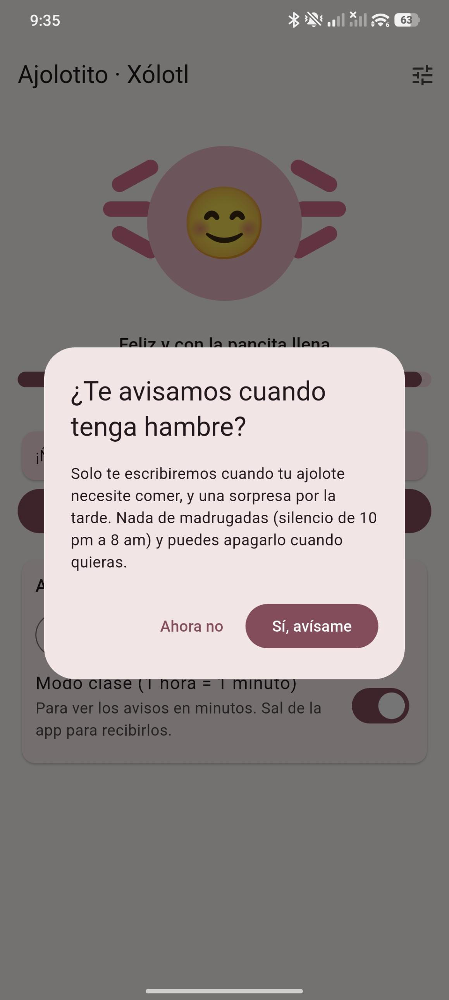
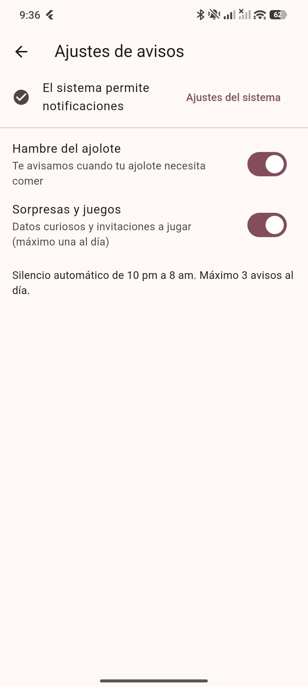

# Ajolotito Hambriento

Mascota virtual para Android: un ajolote al que le da hambre con el paso del tiempo. Cuando tiene hambre, la app te
avisa con una notificación en el teléfono.

La app no manda avisos entre las 10 de la noche y las 8 de la mañana, tiene un límite de avisos al día y solo pide
permiso de notificaciones cuando tú decides activarlas.

## APK

- Lista para instalar: apk/Ajolotito.apk (16.9 MB)
- Salida de Flutter: build/app/outputs/flutter-apk/app-release.apk

Para compilarla:

```bash
flutter build apk --release --target-platform android-arm64
```

El APK funciona en teléfonos arm64 (casi todos los Android recientes). Para instalarlo, copia el archivo .apk al
teléfono, ábrelo y permite instalar apps de origen desconocido.

La app solo pide permiso de notificaciones (Android 13 o más nuevo), y lo hace cuando tocas "Avísame cuando tenga
hambre". Para ver los avisos en pocos minutos, activa el Modo clase (1 hora equivale a 1 minuto) y minimiza la app.

## Estructura del código

Todo el código está en la carpeta lib:

- dominio: las reglas de la mascota (hambre, humor, horarios de silencio, permisos y qué avisos programar).
- infra: la conexión con las notificaciones del teléfono y el almacenamiento de datos.
- presentacion: el dibujo del ajolote y las pantallas de la app (principal y ajustes).
- app.dart y main.dart: el arranque de la app.

La carpeta test tiene las pruebas de la app.

## Capturas de la app

Tomadas en un teléfono con el APK instalado.

Ajolote feliz


Explicación antes del permiso



Avisos programados


Notificación de hambre


Ajustes por categoría



Aviso de que está lleno


## Pruebas rápidas en la app

1. Primera vez: abre la app. No debe aparecer ningún mensaje pidiendo permiso.
2. Antes del permiso: toca "Avísame cuando tenga hambre" y luego "Ahora no". No debe salir el mensaje del sistema.
3. Permiso: toca "Avísame cuando tenga hambre" y luego "Sí, avísame". Sale el mensaje de Android y, al aceptar, aparece la lista de avisos.
4. Prueba inmediata: toca "Probar una notificación ahora". La notificación debe llegar al momento.
5. Modo clase: actívalo y minimiza la app. El aviso de hambre llega a los 6 minutos y el de hambre fuerte a los 8.5.
6. Botón en la notificación: toca "Dar de comer" en la notificación. Se abre la app y el ajolote come.
7. Lleno: toca "Dar de comer" cuando el ajolote acaba de comer. Debe salir "Xólotl está llenísimo; ni un acocil más."

## Cómo correr el proyecto

```bash
flutter pub get
flutter run
```
