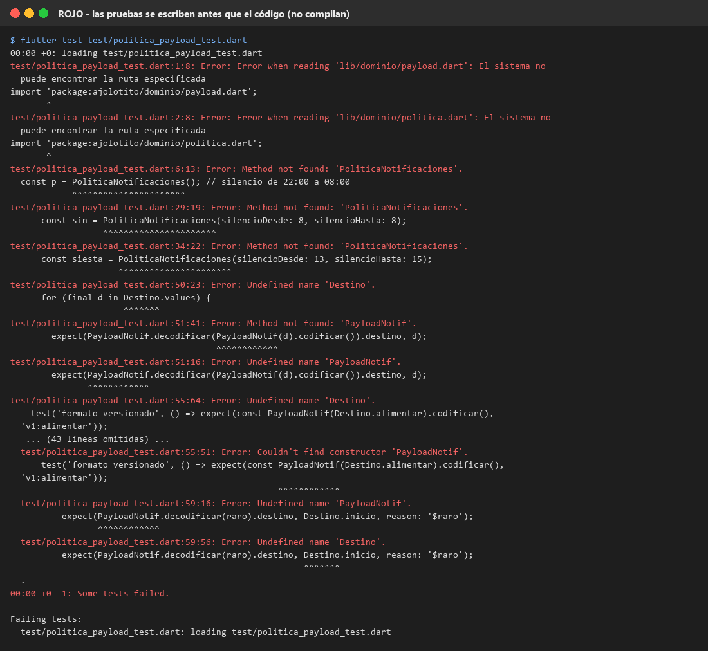
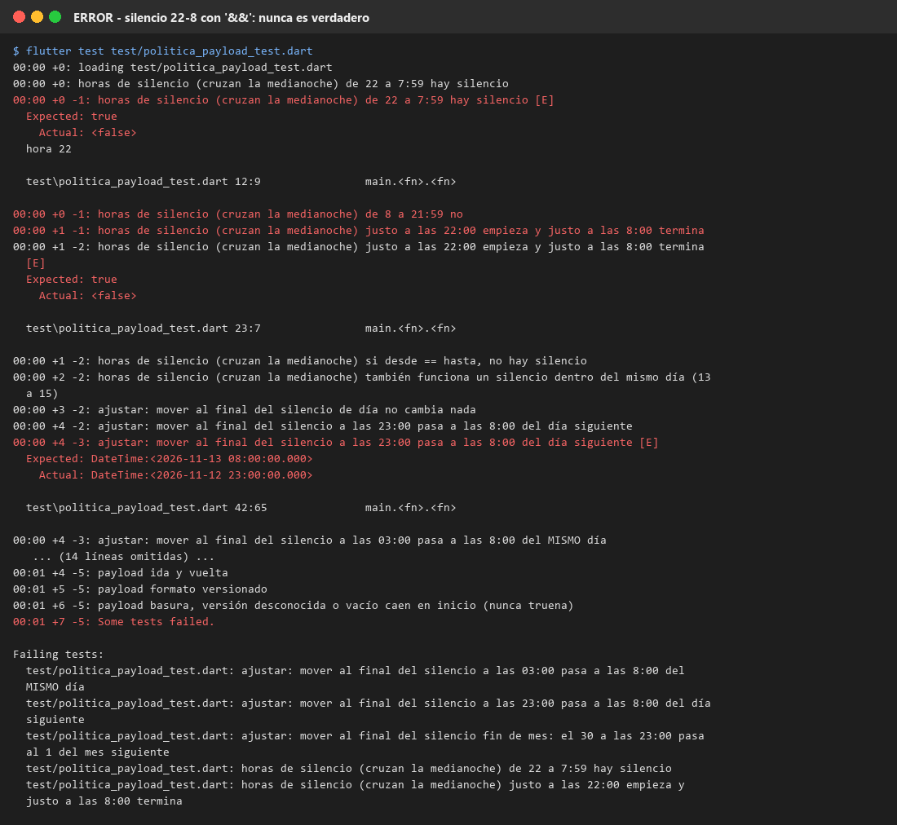
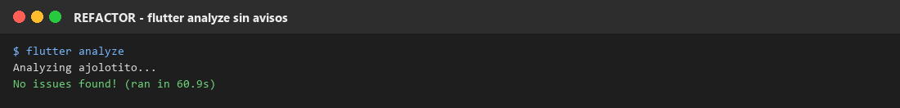
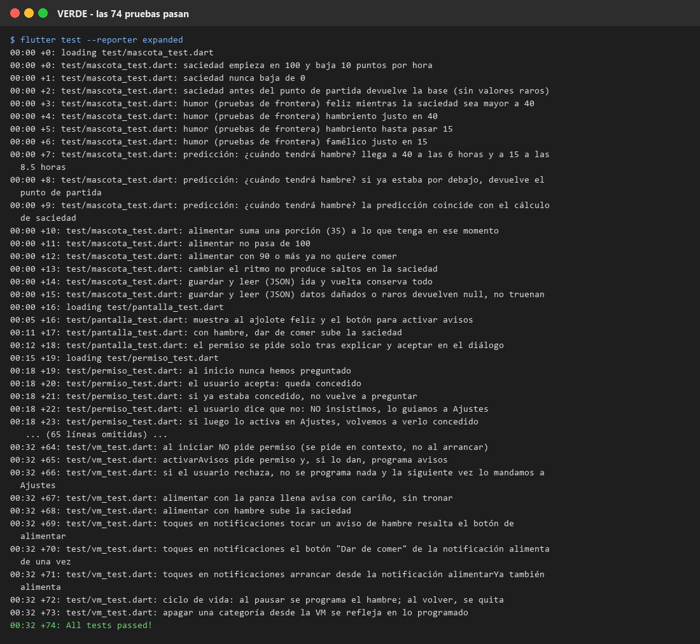
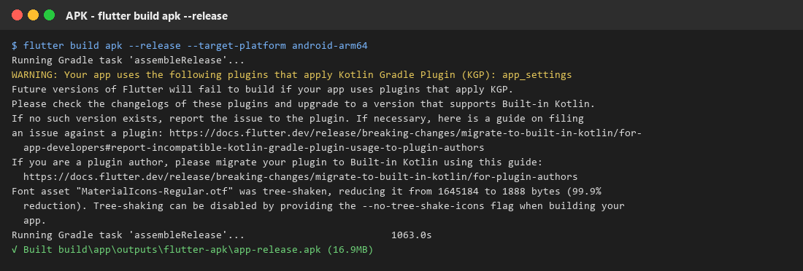
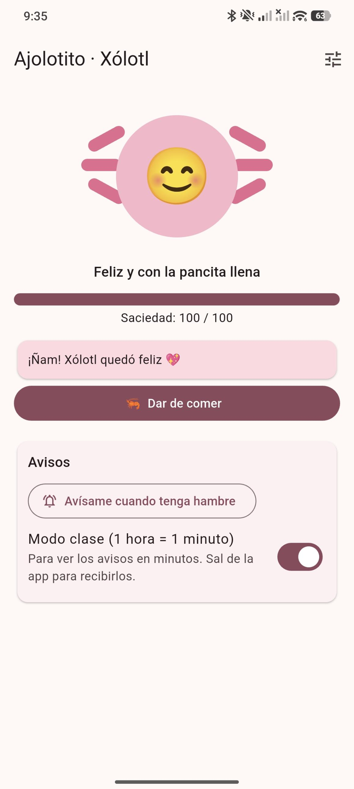
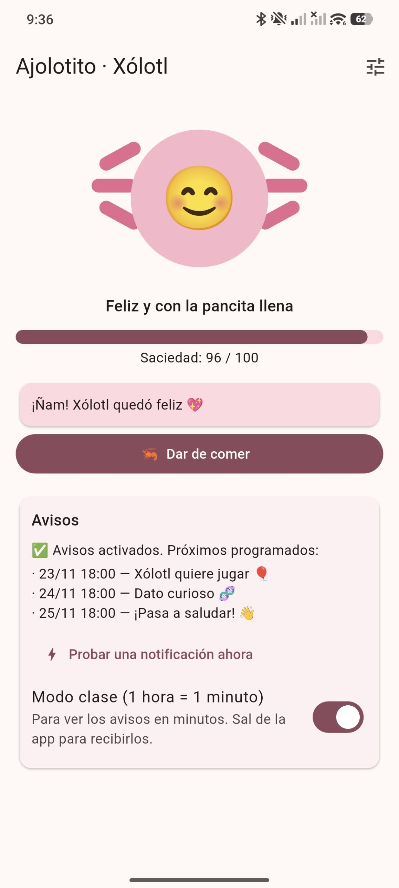
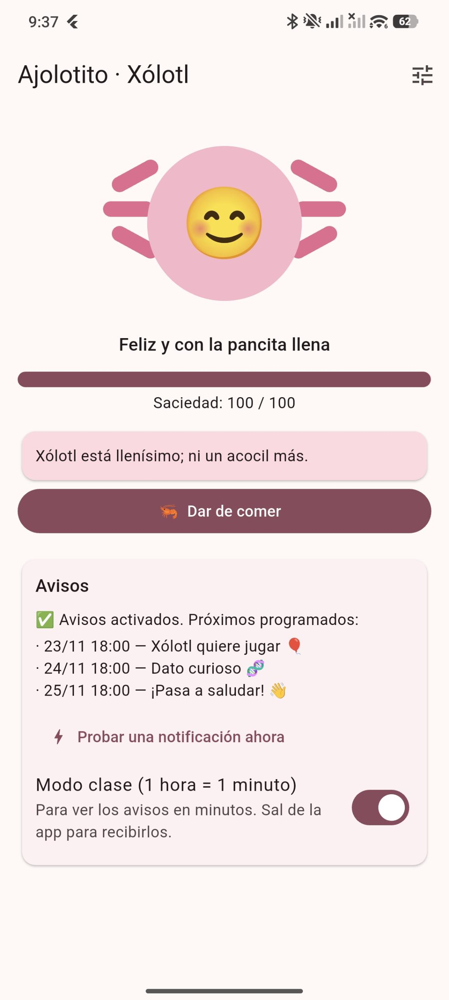

# Ajolotito Hambriento — notificaciones locales bien hechas con TDD

Una mascota virtual (un ajolote) cuya hambre sube con el tiempo; la app **avisa con notificaciones locales** cuando
tiene hambre. Construida con **TDD** siguiendo el *Manual paso a paso con TDD — Ajolotito Hambriento*: reloj
inyectable, predicción del momento del hambre, **horas de silencio (10 pm–8 am)**, tope diario, canales de Android,
payload versionado, ids fijos (reemplazar en vez de duplicar), permiso pedido **en contexto** una sola vez, y el
plugin aislado detrás de un puerto para poder probarlo todo sin teléfono.

---

## 📦 APK

| Archivo | Ruta |
|---|---|
| Lista para instalar | `apk/Ajolotito.apk` (16.9 MB) |
| Salida de Flutter | `build/app/outputs/flutter-apk/app-release.apk` |

```bash
flutter build apk --release --target-platform android-arm64
```

El APK es para teléfonos **arm64** (prácticamente todos los Android de los últimos años). Para instalar: copia el `.apk` al teléfono, ábrelo y acepta *instalar apps de origen desconocido*.

Permiso que pide la app: **notificaciones** (Android 13+), solo cuando tocas *"Avísame cuando tenga hambre"*.
Para verlas en minutos activa **Modo clase** (1 hora = 1 minuto) y minimiza la app.

---

## 🏗️ Estructura

```
lib/
├── dominio/        reloj · mascota · categoria · mensajes · politica · payload · planificador
│                   puerto · almacen · gestor_permiso · servicio            (Dart puro)
├── infra/          puerto_real (ÚNICO archivo que conoce flutter_local_notifications) · almacen_prefs
├── presentacion/   ajolote_vm · dibujo_ajolote · pantalla_ajolote · pantalla_ajustes
├── app.dart · main.dart
test/  falsos · mascota · politica_payload · planificador · permiso · servicio · vm · pantalla
```

---

## 🔴🟢🔵 Evidencia del ciclo TDD

### 1. 🔴 ROJO — las pruebas se escriben primero y fallan

Las pruebas de `test/` se escribieron **antes** que el código. Al correr `flutter test` con `lib/` todavía vacía, nada compila:



### 2. ❌ Error real atrapado por una prueba

La primera versión de las horas de silencio usó la condición "obvia":

```dart
return h >= silencioDesde && h < silencioHasta;   // ❌ con 22 a 8, "h >= 22 Y h < 8" nunca es verdad
```

Es exactamente la trampa que describe el manual: el silencio cruza la medianoche. Cinco pruebas lo atraparon (el
silencio nunca se activaba y `ajustar` no movía los avisos de las 23:00 ni de las 03:00):



**Corrección:**

```dart
return silencioDesde > silencioHasta
    ? (h >= silencioDesde || h < silencioHasta)   // ✅ cruza la medianoche
    : (h >= silencioDesde && h < silencioHasta);  // silencio dentro del mismo día
```

#### Error al compilar el APK: versión del plugin

La primera compilación falló aunque las pruebas estaban en verde: `flutter_local_notifications` **23.x** exige
`compileSdk 37` y `androidx.core 1.19` (`Failed to find target with hash string 'android-37'` y después
`cannot find symbol setSemanticStyle`). Flutter 3.47 compila con la API 36, así que se fijó la versión
**`flutter_local_notifications: ^22.3.3`** (la última con API 36; del lado de Dart la API es la misma).

### 3. 🔵 REFACTOR — limpiar sin romper nada

Con las pruebas en verde se ordenó el código y `flutter analyze` quedó sin avisos:



### 4. 🟢 VERDE — las 74 pruebas pasan



### 5. 📦 Compilación del APK



---

## ✅ Qué cubren las pruebas

| Grupo | Lo que se verifica |
|---|---|
| Mascota | saciedad 100 → -10/h, nunca < 0, humor con fronteras (40 y 15), predicción, alimentar (+35, tope 100, llena), ritmo sin saltos, JSON dañado → null |
| Política | silencio 22–8 cruzando la medianoche, siesta 13–15, ajustar al día siguiente y al cambiar de mes |
| Payload | ida y vuelta, `v1:`, basura/versión futura → inicio |
| Planificador | día normal exacto, silencio, colapso hambre+crítico, nada en silencio en las 24 h, categorías apagadas, tope diario, ids únicos |
| Permiso | nunca pregunta al consultar, acepta, ya concedido, rechazo → Ajustes sin insistir |
| Servicio y VM | sincronizar idempotente, sin permiso no programa, alimentar reemplaza avisos, primer/segundo plano, modo clase, toques en notificaciones |

```bash
flutter test
```

---

## 📱 Capturas de la app

> Tomadas en un teléfono físico con el APK instalado. *Guarda tus capturas en `capturas/` con estos nombres y aparecerán aquí automáticamente.*

| Ajolote feliz | Explicación antes del permiso | Avisos programados |
|---|---|---|
|  |  |  |

| Notificación de hambre | Ajustes por categoría | Aviso: está llenísimo |
|---|---|---|
|  |  |  |

### Qué probar en la app

| Caso | Qué hacer | Resultado esperado |
|---|---|---|
| Primera vez | Abre la app | NO aparece ningún diálogo de permiso |
| Pre-permiso | "Avísame…" → "Ahora no" | No sale el diálogo del sistema |
| Permiso | "Avísame…" → "Sí, avísame" | Diálogo de Android; al aceptar se listan los avisos |
| Prueba inmediata | "Probar una notificación ahora" | Llega al instante |
| Modo clase | Actívalo y minimiza la app | Aviso de hambre a los 6 min y crítico a los 8.5 |
| Botón en la notificación | Toca "Dar de comer 🦐" | Abre la app y alimenta al ajolote |
| Lleno | "Dar de comer" recién nacido | "Xólotl está llenísimo; ni un acocil más." |

---

## 🛠️ Cómo correr el proyecto

```bash
flutter pub get
```

```bash
flutter test
```

```bash
flutter run
```

